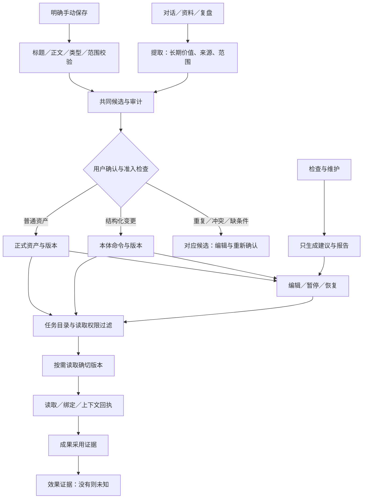

# CogSeed 认知资产收敛与全链路梳理

2026-10-08；开发位置 CogSeed 源仓库，分支 `dev/牛保康-10.1`，起点 `edffbbf9`。用户授权按职责与依赖盘点、减法、全链路和实际验收推进。本记录替代前一份诊断中的初步减法清单，作为本轮实施与保留边界；各项完成度以末尾验证记录为准。

## 1. 用户任务和页面职责

| 用户要完成的事 | 日常落点 | 必须保留的能力 | 本轮收敛 |
|---|---|---|---|
| 写下一条明确要保存的内容 | 我的认知／记一条 | 原文、类型、范围、明确确认、校验、失败落点 | 一次确认直接尝试正式保存；价值说明移入高级选项；规则填写真实适用／排除边界 |
| 判断系统提取的内容是否值得保留 | 待我处理 | 来源、修改、拒绝、冲突与范围 | 自动提取只产生候选，删除已失效的自动发布分支；临时任务限制不自动推广为长期规则 |
| 查找、编辑、暂停已有内容 | 我的认知／对应详情 | 来源、版本、编辑、启停、历史 | 常规资产与经验、本体目录分别计数；同一使用事实计算次数与时间 |
| 维护结构化对象、事实与规则 | 本体／对象详情 | 正常编辑、时间事实、关系、权限、历史 | 保留核心职责和独立数据语义；不把本体整体藏进高级功能 |
| 看任务读了什么、怎样采用 | 任务答复／内容详情 | 确切版本、查询／读取／采用／效果各级证据 | 答复记忆卡说明引用记录与采用、效果的区别；不通过更名伪造后台效果 |
| 核对系统做了什么 | 系统活动 | 保存与检查记录、失败、重试、历史 | 整理条目按整理发生时间排序，运行优先明示；等待任务不再被“正在跑”提示覆盖 |
| 安排自动处理和维护 | 资产设置 | 开关、时间、检查、历史与恢复 | 所有维护触发只检查并生成建议，退役批量改标题／正文／候选正文／合并／打标签 |
| 可选观察内容关系 | 认知树／本体图谱 | 已确认关系、查看详情、可访问操作 | 保留查询与观察职责；不新增重复汇总页，不替代正式编辑路径 |

页面数量不是收敛成果指标。没有新增页面、第二套候选池或第二套正式保存；合并共同职责，保留不同内容必要的表单和业务语义。

## 2. 减法决定与承接路径

| 决定 | 代码／依赖证据 | 承接与兼容 |
|---|---|---|
| 合并手动保存的两次用户操作 | `core.js::saveManualCandidate` 原来 save 后跳 review；现有 promote 通道已有审核、权限、查重和基线检查 | 后台仍保留候选审计，用户一次确认依次走既有 save 和 promote；成功进确切资产详情，受阻进确切候选；保存前失败保留表单 |
| 删除自动提取中的不可达发布工作流 | `capture-service.ts` 固定 `automaticMode=false`，但仍带 eligible IDs、自动 apply helper、发布状态及终态快照分支 | 删除实际不可达分支和对应依赖；保留历史 autoWrite／writing／reviewSnapshot 的读兼容，旧设置不构成发布授权 |
| 退役日常维护的批量写入 | `maintenance.run`、`cleanup.run` 调用 full／旧专项轮；规则轮仅 inspection 不写，但 user 可改；模型轮直接 actor=ai 写标题、正文、候选 | 统一 `runAssetCleanup` 只形成建议；旧导出函数／IPC 调用形状继续可用但返回 `mode=report_only`；编辑从详情显式发起，合并按对象影响预览确认；旧报告及恢复锚点继续可读 |
| 合并次数与最近时间的计算 | `views.js` 原来计数和 max 时间两套筛选；无 projection 的 injected 不计数却更新时间 | `taskExposureProofs` 统一筛选／按 projection 去重，无 projection 的真实注入计入；反馈、撤销、版本修改不刷新曝光计数和时间；采用证据仍独立 |
| 删除未经证明的来源删除结论 | 多数来源“目录查无”被渲染为“会话已删除”；实机反例能打开父会话 | 中性“来源待核对／暂时无法核对”；保留原始证据和可用跳转；不把找到父会话当作确切引文已核实，不强行解锁审核 |
| 限制自动提取的长期推广 | 原先质量检查主要降级为 weak，仍可能让临时规则进入池；来源持久性与是否确认混在一起 | 判断规则 create 来源是否明确限制于本次任务，且没有长期复用意图；自动任务省略此类提案；手动选择、明确长期规则、模板和方法不按“验收／调试”主题词过滤 |
| 精简默认字段和过度使用宣称 | 手动首屏要求价值；答复卡标题“本次使用”，各行“已引用”，没有证据边界 | 价值按需；“本次关联的认知／引用记录”，说明带入和读取不能证明采用和效果；原记录、反馈能力保留 |

## 3. 写入来源的保留审计

下列路径承担不同触发／内容职责。没有因为多个函数或物理载体就认定它们重复，未删除数据桥与迁移文件。

| 来源 | 入口／共同边界 | 保留理由与检查重点 |
|---|---|---|
| 手动输入 | Renderer → candidates.save → candidate-service → 用户 promote | 明确授权原文，复用正式晋升，不绕过查重、权限或类型门禁 |
| 会话提取 | capture-service → submitCognitionCandidate → canonical pipeline → candidate-service | 自动来源只能候选；任务范围、证据与临时限制筛选；失败可恢复 |
| KSTAR／直接经验 | recall-bridge／direct-experience → 候选提交；episode／trace 独立运行记录 | KSTAR 来源和经验语义不同，不能删除复盘或冒充正式资产；确认边界与采用证据保留 |
| 会议结论、会话导入、教学 | 各自解析／直接 saveRecallCandidate → 同一服务／池 | 输入形态不同，仍进入共同候选服务；直接调用不是第二个池，也不是自动发布授权 |
| 本体资料导入 | ontology import → 原文／提取建议 → 共同候选 → 用户本体命令提交 | 原始资料、结构化变化预览、权限、基线与回读；禁止资料内指令产生写授权 |
| 普通候选整理进本体 | candidate-handoff → commitOntologyCommand → 内核 apply | 与普通资产晋升语义不同，保留不能表达的范围拒绝、基线检查和原候选关联 |
| 旧记忆／旧本体 | 迁移确认与兼容 bridge | 仍有消费者和恢复需求，保留身份、来源、权限和版本；未自动迁移真实数据 |
| 实验内核分支 | pipeline 非 canonical 路由 | 本轮没有将零直接调用等同于可安全删除；隔离于生产契约，不新增用户入口 |

## 4. 保留后的全链路

### 每一步要成立的事实

1. **输入**：自动生成、明确保存、用户选择资料是不同授权；当前任务限制不能偷偷升级成长期规则。
2. **提交**：调用成功必须拿到候选 ID；候选存在不等于正式资产存在。用户选择保存后，后台审计不要求第二次无意义点击。
3. **晋升／本体提交**：准入、消歧、范围、风险和基线校验仍成立；整合本体不等同普通资产晋升。
4. **失败**：提交前失败保留表单；晋升受阻保留已提交候选并进入同一条处理；不显示“已保存”或要求再提交一份。
5. **回读**：成功打开确切资产，本体打开确切对象／历史版本；后台失败不得用空态或零计数替代。
6. **任务读取**：正式、启用、允许的内容才可读取。目录存在不等于读取，读取不等于采用。
7. **采用／效果**：分别要求对应证据；没有证据时未知。引用卡与反馈不能制造已验证效果。
8. **变更后**：暂停阻止后续读取，过去任务仍保留当时版本和回执；修改产生新版本，历史不被覆盖。
9. **维护**：建议只是建议，报告记录当前模式；旧 applied 报告不改写为“从未执行”，恢复入口保留。
10. **时间线**：正在运行优先，其余按事件发生时间；正文更新时间、反馈时间和使用时间分别有自己的语义。

## 5. 仍需明确的产品边界

- 规则 applicableWhen 属于模型适用指导，权限、禁用、状态等是硬过滤。不能把本轮状态修正宣称为所有任务的语义相关性已解决。
- 普通资产、经验和本体当前各有语义和兼容读取；统一治理不要求一张通用表，也不证明所有历史投影都已退役。
- 六页职责保留，本轮未盲目删除图谱、本体和恢复能力；认知树解释、默认导航以及实验历史的进一步隔离需要对应用户任务验证。
- 只检查模式的建议需在内容详情中手动执行；未建立批量建议自动确认出口。
- 约两周真实数据门仍未满足，不能靠测试数据完成效果度量验收。
- 页内结构登记保留 Proposed，不由代理代签代码负责人批准。

## 6. 本轮验证

- 完整 `npm test`：1356 个 JS 测试文件通过，14962 项通过；29 个文件、102 项按原配置跳过。资源测试308项通过。最终树文案、规则表单展开、报告摘要和保存未确认提示修正后，相关4文件163项再次通过。
- 保存→正式资产→任务准入→读取确切版本→暂停阻止后续读取→原版本和回执保留：隔离用户的真实服务测试通过。读取不会伪造实际采用回执。
- typecheck、lint 与 `git diff --check` 通过。CodeRabbit 首轮2条轻微发现（摘要计数参数、四语未确认提示），均核实修正；复查另发现同正文重复建议、已处理候选被误记为无候选2项，均修正；后台相关111项及新增明确断言后的110项通过。未把两轮审查的发现数描述为0。
- 原 `cogseed` runtime、同一用户数据重启并进行原生窗口复核：六页导航、常规资产/经验/本体归属、手动表单与取消、待处理来源核对表述、活动顺序、新旧报告分别展示。没有在真实库新增虚构资产。
- 原生窗口实际执行检查，扫描26条，建议0项，内容未修改；检查前后1724个已有 Recall 文件 SHA-256 完全一致。只读检查会新增报告，报告不计入内容一致性比较。
- 截图已核对资产设置与系统活动；其他部分以原生可访问性树和点击状态为证。未宣称四语全部真实点击、全部导入格式、模型语义相关性或两周业务效果完成验收。

## 7. 最终减法补充

删除无调用者的 renderer `runCleanup` 动作；删除无证据的“未打标签就需要分类”泛化建议；报告不重复显示同一建议的改动表与待判断表。规则边界只在选择规则时展示并展开；零次读取提示只出现一次。认知树不再用“真实使用验证”描述读取记录。
